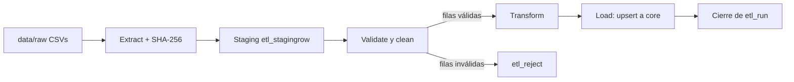

# 5. Pipeline ETL

## Flujo

## Etapas

1. **Extract:** `python manage.py run_etl` lee los CSV de `data/raw/` (o de `--input`), calcula SHA-256 y omite archivos ya cargados.
2. **Staging:** conserva las filas originales como JSON en `etl_stagingrow` antes de limpiar.
3. **Validate y clean (Pandas):** aplica las reglas de la tabla siguiente fila por fila; una fila inválida se guarda en `etl_reject` sin detener las demás.
4. **Transform:** normaliza tipos, mapea estados, convierte zonas horarias y calcula campos derivados (por ejemplo `promised_at`).
5. **Load:** upsert a `core` en orden de dependencias, dentro de una transacción por archivo: `warehouse, carrier, product, customer → sales_order → order_item → shipment → product_return`.
6. **Log:** cierra el `etl_run` con conteos y estado.
7. **Analytics (pendiente):** refrescar las vistas materializadas cuando se
   implementen en la fase de KPIs.

## Reglas de validación

| Código | Regla | Acción |
|---|---|---|
| `DUP_ORDER` | `external_id` de pedido repetido | Corregir: conservar el último |
| `SKU_FMT` | SKU con espacios o minúsculas | Corregir: normalizar |
| `SKU_UNKNOWN` | SKU no existe en el maestro | Rechazar |
| `STATUS_MAP` | Estado con variantes ("ENTREGADO", "Entregado ") | Corregir: mapear |
| `DATE_INVALID` | Fecha imposible (componentes fuera de rango) | Rechazar |
| `DATE_FMT` | Fecha válida en formato mixto | Corregir: parsear al formato estándar |
| `DATE_ORDER` | `delivered_at < shipped_at` | Rechazar |
| `REGION_FMT` | Región escrita con una variante textual | Corregir: normalizar |
| `AMOUNT_NEG` | Monto o cantidad <= 0 | Rechazar |
| `CUST_EMAIL_NULL` | Cliente sin email | Advertencia: cargar igual |

El generador actual implementa e incluye en sus pruebas `DUP_ORDER`, `SKU_FMT`,
`SKU_UNKNOWN`, `STATUS_MAP`, `DATE_INVALID`, `DATE_FMT`, `DATE_ORDER`,
`REGION_FMT` y `AMOUNT_NEG`. `CUST_EMAIL_NULL` está definido como regla de advertencia, pero el generador
actual no crea clientes sin email y aún falta persistir esa advertencia. Las
transformaciones principales y sus reglas tienen tests unitarios; falta la
verificación de integración contra PostgreSQL.

El generador marca filas sucias en `data/raw/catalogo_suciedad.csv`, con el nombre
del dataset, el número de línea (`source_row`, donde 1 es el encabezado), la clave
del registro (`record_key`), el `rule_code` y el motivo (`reason`). La línea
registrada permite localizar el dato en el CSV correspondiente. Este catálogo es
metadata de prueba; no forma parte de los CSV de entidades. Detalles de volumen,
semilla y ejecución: [Fuente de datos](04-fuente-de-datos.md).

## Reglas de operación

- Una fila rechazada no detiene la corrida: se guarda en `etl_reject` con su motivo y el dato original.
- Por ahora, cualquier corrección o rechazo marca la corrida como "con advertencias"; falta fijar el umbral de rechazo.
- Reejecutar el mismo archivo no duplica datos; solo el hash de un archivo
  cargado exitosamente se usa para omitir futuras ejecuciones.
- **División de trabajo:** la limpieza va en Pandas; las agregaciones y los KPIs van en SQL. Justificar esta decisión en el README.
- Ejecución con `python manage.py run_etl`. Celery queda para v2.

## Pendiente

- [ ] Fijar el umbral de rechazo que marca una corrida con advertencias.
- [ ] Definir el catálogo de motivos de devolución.
- [ ] Registrar la advertencia `CUST_EMAIL_NULL` sin contarla como rechazo.
- [ ] Verificar el comando de extremo a extremo contra PostgreSQL.

Anterior: [Fuente de datos](04-fuente-de-datos.md) | Siguiente: [KPIs](06-kpis.md)
